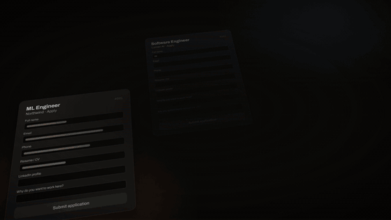

<div align="center">


# JobPilot

**An AI agent that applies to jobs for you, using the Claude or Codex subscription you already have.**

[](https://github.com/suxrobGM/jobpilot/releases)
[](https://github.com/suxrobGM/jobpilot/actions/workflows/ci.yml)
[](LICENSE)
[](https://bun.sh)
[](https://nextjs.org)
[](https://dotnet.microsoft.com)

[**Open JobPilot →**](https://jobpilot.suxrobgm.net) &nbsp;·&nbsp; [Docs](https://jobpilot.suxrobgm.net/docs) &nbsp;·&nbsp; [How it works](docs/architecture.md) &nbsp;·&nbsp; [Changelog](CHANGELOG.md)

[](apps/web/public/teaser.mp4)

*[Watch it full size →](https://jobpilot.suxrobgm.net#see-it-run)*

</div>

---

JobPilot finds jobs that fit you, tailors your resume for each one, fills in
the application, and writes to recruiters. You describe what you want once.
The Pilot, an assistant on the JobPilot website, keeps the search going and
asks you when it needs a decision.

The agent runs on your computer, inside Claude Code or Codex, in a browser
window signed in as you. There's no API key and no usage bill. You can watch
it work or check the results later.

## What it does

- **Finds and applies.** Searches LinkedIn, Indeed, Hiring Cafe and other
  boards, plus any site you add. Scores each job against your resume and
  applies to the good matches, up to your daily limit. Answers screening
  questions and writes cover letters.
- **Takes instructions in plain words.** "Skip jobs that need a security
  clearance" or "look for remote roles too". Every change it makes has Undo.
- **Asks before it acts on your behalf.** Salary questions, login codes, and
  messages to send wait in a **Needs you** list, with optional push
  notifications to your phone.
- **Tracks replies.** With Gmail connected, it matches recruiter emails to
  your applications and suggests the new status.
- **Reaches out.** Finds the recruiter or hiring manager for a job and drafts
  a personal email or LinkedIn message.
- **Works on Upwork.** Skips clients who rarely hire, drafts proposals, and
  collects invitations, offers, and messages.

## Get started

You need a Claude Code or Codex subscription and
[Node.js](https://nodejs.org) 22 or newer.

**Claude Code:** run these in a Claude Code session:

```text
/plugin marketplace add https://github.com/suxrobGM/claude-plugins
/plugin install jobpilot@sukhrob-claude-plugins
/jobpilot:setup
```

**Codex:** run these in a terminal, then run `$setup` in a new Codex session:

```text
codex plugin marketplace add suxrobGM/codex-plugins
codex plugin add jobpilot@sukhrob-codex-plugins
```

Setup installs the terminal host (the small program that runs the agent),
starts it, and opens JobPilot. Then:

1. [Create an account](https://jobpilot.suxrobgm.net/register) and upload
   your resume. The agent reads it and fills in your profile.
2. On the **Pilot** page, write your goals, then turn on **Autopilot**.

Setup is the only command you type. Everything else starts from the website.
Run setup again any time to update or repair the install.

The [getting started guide](https://jobpilot.suxrobgm.net/docs/getting-started)
covers each step.

<details>
<summary><b>Install the terminal host without the plugin</b></summary>

The host ships with all the skills, so the marketplace plugin is only needed
for the first setup. To install or repair the host directly:

- **Windows (PowerShell):**

  ```powershell
  irm https://raw.githubusercontent.com/suxrobGM/jobpilot/main/apps/terminal/install.ps1 | iex
  ```

- **macOS / Linux:**

  ```bash
  curl -fsSL https://raw.githubusercontent.com/suxrobGM/jobpilot/main/apps/terminal/install.sh | bash
  ```

</details>

## Skills

Buttons on the website ask the Pilot for work, and it runs next on your
agent. You can also type a skill in the terminal yourself, like
`/jobpilot:search` or `/jobpilot:apply <link>` (`$search`, `$apply` in
Codex). The [skills guide](https://jobpilot.suxrobgm.net/docs/skills) lists
every button and skill.

## Documentation

- [User guide](https://jobpilot.suxrobgm.net/docs): setup, the Pilot,
  skills, email, credentials, FAQ.
- [How JobPilot works](docs/architecture.md): the website, the agent, and
  the terminal host, in plain language.
- [Development guide](docs/development.md): running JobPilot locally and the
  technical details.

## License

MIT. The humanizer skill in
[plugin/skills/humanizer/](plugin/skills/humanizer/) is adapted from
[blader/humanizer](https://github.com/blader/humanizer) (MIT) and keeps its
own LICENSE file.
